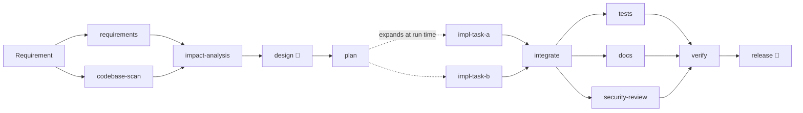

# Agentic SWE: governed SDLC orchestration, applied to a URL shortener

An agentic software-engineering system that turns a requirement into a **reviewable engineering
outcome**: a tested, documented patch with a traceability matrix, release notes and a
tamper-evident audit trail. Agents do the multi-step work; a governed workflow engine decides what
is accepted; humans approve high-impact changes and own the final release.

The system is demonstrated on a URL shortener (Spring Boot 4, PostgreSQL) that it builds
(greenfield), evolves (brownfield) and clarifies requirements for (ambiguous).



<sub>Brownfield workflow. 👤 = mandatory human sign-off; policy adds more checkpoints for
high-impact changes (schema migrations, dependency or API-contract changes). Parallel branches
join at `integrate` and `verify`.</sub>

## What makes it different

- **A real workflow engine, not a prompt chain.** A pure Java 21 graph engine
  ([`orchestrator-core`](orchestrator-core)) runs independent nodes in parallel on virtual
  threads, joins them, expands the graph at run time from the plan, and re-plans by invalidating
  exactly the nodes whose inputs changed.
- **Agents propose, the engine decides.** Agents never write files. Every proposal passes policy
  guardrails, then deterministic gates (compiler, tests, Checkstyle, coverage, API-compatibility,
  grounding checks). A failed attempt is rolled back to the last green git checkpoint and retried
  with the evidence, within bounded budgets.
- **Humans own the high-impact decisions.** Design and release always need sign-off; policy forces
  approval for migrations, dependency changes and API-contract changes, and cannot be opted out.
  Reviewers can approve, reject with feedback (the agent retries) or edit any artifact (the engine
  re-plans downstream).
- **Audit-grade by construction.** One append-only, hash-chained event log is the single source of
  truth: the audit trail, decision lineage, reliability metrics (success rate, retry/rollback
  rates, MTTR, end-to-end latency), the HTML run report and resume-after-stop are all derived from
  it.

## Quickstart

Prerequisites: Java 21, Maven 3.9+, Docker (Testcontainers and local PostgreSQL).

```bash
mvn verify                                     # all modules: 234 tests, Checkstyle, 80% coverage gates
./agentic run drill                            # governance drill: no API key, ~25 s, finishes green
open .runs/drill-*/report.html                 # graph, metrics, checkpoints, lineage, gate evidence
./agentic metrics                              # reliability metrics across runs
./agentic verify-log <run-id>                  # verify the audit log's hash chain
```

The **drill** runs the real brownfield workflow (same templates, agents, policy, gates and Maven
builds) with hand-authored model replies and planted faults: a hallucinated file, a reviewer
amendment that forces re-planning, an edit to an applied migration, a compile failure and a model
outage. See [docs/scenarios/drill.md](docs/scenarios/drill.md).

Live runs use Gemini through LangChain4j:

```bash
cp .env.example .env       # set GEMINI_API_KEY and AGENTIC_MODEL (git-ignored)
./agentic run brownfield --llm record --approvals interactive   # you are the reviewer
./agentic run brownfield                                         # replays the recording, no key
```

`./agentic stop <run-id>` engages the kill switch (safe stop); `./agentic resume <run-id>` continues
from the log without repeating accepted work.

## Scenarios

| Scenario | Starts from | Demonstrates |
|---|---|---|
| [`drill`](docs/scenarios/drill.md) | v1 service | Every control under failure, deterministically (no model) |
| [`brownfield`](docs/scenarios/brownfield.md) | v1 service | Impact analysis, enhancement + bug fix, reviewer rejection loop, schema-change approval |
| [`greenfield`](docs/scenarios/greenfield.md) | empty Spring Boot scaffold | Building the service from a requirement |
| [`ambiguous`](docs/scenarios/ambiguous.md) | v1 service | Detecting ambiguity, stakeholder clarification at a checkpoint, re-planning |

## Repository

| Path | What |
|---|---|
| [`orchestrator-core`](orchestrator-core) | Graph engine: scheduler, node lifecycle, gates, policy, approvals, git workspace, event log, metrics. No Spring, no LLM. |
| [`orchestrator-agents`](orchestrator-agents) | SDLC agents on LangChain4j, record/replay, JavaParser codebase index, contract and grounding gates |
| [`orchestrator-app`](orchestrator-app) | `agentic` CLI: workflow templates, console approvals, live progress, HTML report, metrics |
| [`url-shortener`](url-shortener) | The service: v1 baseline and brownfield target ([README](url-shortener/README.md)) |
| [`scenarios`](scenarios) | Scenario definitions and the greenfield scaffold |
| [`cassettes`](cassettes) | Recorded or hand-authored model replies for offline replay |
| [`config`](config) | Checkstyle rules and the engineering conventions given to code-writing agents |

## Documentation

- [Architecture](docs/architecture.md): components, orchestration model, control flow, state
- [C4 model](docs/c4-model.md): context, container, component and dynamic views of the workflow
- [Key methods](docs/key-methods.md): the important methods of every module, one line each
- [Architecture decision records](docs/adr): the key choices and their trade-offs
- [Requirements](docs/requirements.md) and the [traceability matrix](docs/requirements-traceability.md)
- [Testing approach](docs/testing.md)
- [Risks, trade-offs and limitations](docs/risks-and-limitations.md)
- [AI collaboration log](docs/ai-collaboration-log.md): where AI was used and where judgment overrode it
- [Final engineering summary](FINAL_SUMMARY.md)
