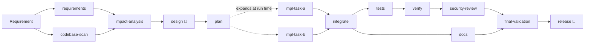

# Agentic SDLC Orchestrator: governed software delivery, applied to a URL shortener

An agentic software-engineering system that turns a requirement into a **reviewable engineering
outcome**: a tested, documented patch with a traceability matrix, release notes and a
tamper-evident audit trail. Agents do the multi-step work; a governed workflow engine decides what
is accepted; humans approve high-impact changes and own the final release.

The system is demonstrated on a URL shortener (Spring Boot 4, PostgreSQL) that it builds
(greenfield), evolves (brownfield) and clarifies requirements for (ambiguous).



<sub>Brownfield workflow. 👤 = mandatory human sign-off; policy adds checkpoints for high-impact
changes: build-file changes need authorization *before* they are written or built; schema
migrations, API-contract changes and large changes need acceptance of the validated result.
Parallel branches join at `integrate` and `final-validation`, which re-runs every deterministic
check on the one tree that release is then bound to.</sub>

## What makes it different

- **A real workflow engine, not a prompt chain.** A pure Java 21 graph engine
  ([`orchestrator-core`](orchestrator-core)) runs independent nodes in parallel on virtual
  threads, joins them, expands the graph at run time from the plan, and re-plans by invalidating
  exactly the nodes whose inputs changed.
- **Agents propose, the engine decides.** Agents never write files. They read a snapshot of the
  revision they started on; every proposal passes policy guardrails, a stale-file check, then
  deterministic gates (compiler, tests, Checkstyle, coverage, structural API compatibility,
  grounding checks). Any failure, including exceptions, restores the last accepted git checkpoint;
  the attempt is retried with the evidence, within bounded budgets.
- **Humans own the high-impact decisions.** Execution-sensitive changes (the build file) are
  authorized before anything runs; design, release, migrations, API-contract and large changes are
  accepted on the exact validated tree. Approvals fail closed: nothing is approved by default, an
  unreachable reviewer pauses the run. Reviewers can approve, reject with feedback (the agent
  retries) or amend artifacts (validated, then the engine re-plans downstream).
- **Audit-grade by construction.** One append-only, hash-chained event log is the single source of
  truth: the audit trail, decision lineage, reliability metrics (success rate, retry/rollback
  rates, MTTR, end-to-end latency), the HTML run report and resume-after-stop are all derived from
  it.

## Quickstart

Prerequisites: Java 21, Maven 3.9+, Docker (Testcontainers, local PostgreSQL, optional sandbox).

```bash
mvn verify                                          # all modules, Checkstyle, 80% coverage gates
./agentic run drill                                 # governance drill: planted faults, ~35 s
./agentic run brownfield --approvals scripted       # analytics + issue #1 fix, ~40 s
./agentic run greenfield --approvals scripted       # builds the v1 service from a scaffold
./agentic run ambiguous  --approvals scripted       # clarification round, then delivery
./agentic check-evidence drill greenfield brownfield ambiguous   # committed evidence holds
open .runs/brownfield/report.html                   # graph, metrics, approvals, lineage, gates
```

**What these runs are.** The four scenarios replay **hand-authored model replies** (labelled
`fixture` in every audit log) through the real workflow: agents, policy, gates, Maven builds on
PostgreSQL, approvals. They demonstrate the orchestration and produce real, validated code; they
do not demonstrate model quality. The reviewer is `--approvals scripted`: **demonstration
decisions** written in each scenario file, recorded as `scripted-demo`, never as a human. Live
model runs and their status are described in [docs/scenarios](docs/scenarios/README.md).

Run as the reviewer yourself (any scenario): `./agentic run brownfield --approvals interactive`.
Without a terminal and without `--approvals`, a live run refuses to start rather than auto-approve.

Live runs use Gemini through LangChain4j (`cp .env.example .env`, set `GEMINI_API_KEY` and
`AGENTIC_MODEL`), recorded into a separate cassette set:

```bash
./agentic run brownfield --llm record --cassettes brownfield-live --approvals interactive
```

`./agentic stop <run-id>` engages the kill switch (safe stop); `./agentic resume <run-id>` verifies
the log and artifacts, then continues without repeating accepted work. `--sandbox docker` runs every
build and test in a container without network or host secrets (`./agentic warmup-sandbox` once).

### The URL shortener

`url-shortener/` is the **v1 baseline** the brownfield and ambiguous scenarios start from. The
**final service** (v1 + click analytics + the issue #1 fix) is v1 plus the patch the brownfield run
validated and released; it is produced, not duplicated:

```bash
tools/final-service.sh                     # -> target/final-service
cd target/final-service && mvn verify      # 153 unit + 24 integration tests, coverage gate
docker compose up -d && mvn spring-boot:run
open http://localhost:8080/swagger-ui.html
```

## Scenarios

| Scenario | Starts from | Demonstrates | Evidence |
|---|---|---|---|
| [`greenfield`](docs/scenarios/greenfield.md) | empty Spring Boot scaffold | Requirement to a working service in 6 dependent tasks; build-file change authorized before execution | [docs/evidence/greenfield](docs/evidence/greenfield) |
| [`brownfield`](docs/scenarios/brownfield.md) | v1 service | Impact analysis, enhancement + bug fix, reviewer rejection loop, schema-change approval; produces the final service | [docs/evidence/brownfield](docs/evidence/brownfield) |
| [`ambiguous`](docs/scenarios/ambiguous.md) | v1 service | Questions, labelled demonstration answers, refinement, then delivery | [docs/evidence/ambiguous](docs/evidence/ambiguous) |
| [`drill`](docs/scenarios/drill.md) | v1 service | Every control under failure: grounding, re-planning, policy block, compile rollback, model outage | [docs/evidence/drill](docs/evidence/drill) |

All four use hand-authored model replies; see each page for provenance and limits.

## Repository

| Path | What |
|---|---|
| [`orchestrator-core`](orchestrator-core) | Graph engine: scheduler, node lifecycle, gates, policy, approvals, git workspace, event log, metrics. No Spring, no LLM. |
| [`orchestrator-agents`](orchestrator-agents) | SDLC agents on LangChain4j, record/replay, JavaParser codebase index, contract and grounding gates |
| [`orchestrator-app`](orchestrator-app) | `agentic` CLI: workflow templates, console approvals, live progress, HTML report, metrics |
| [`url-shortener`](url-shortener) | The v1 baseline service ([README](url-shortener/README.md)); the final service is produced by `tools/final-service.sh` |
| [`scenarios`](scenarios) | Scenario definitions and the greenfield scaffold |
| [`cassettes`](cassettes) | Hand-authored model replies for offline replay (generated by `tools/make-*-cassettes.py`) |
| [`tools`](tools) | Fixture generators and sources, `final-service.sh`, the redirect load test |
| [`config`](config) | Checkstyle rules and the engineering conventions given to code-writing agents |

## Documentation

- [Architecture](docs/architecture.md): components, orchestration model, control flow, state
- [C4 model](docs/c4-model.md): context, container, component and dynamic views of the workflow
- [Key methods](docs/key-methods.md): the important methods of every module, one line each
- [URL shortener API guide](url-shortener/API.md): each endpoint with sample requests and every response
- [Architecture decision records](docs/adr): the key choices and their trade-offs
- [Requirements](docs/requirements.md) and the [traceability matrix](docs/requirements-traceability.md)
- [Testing approach](docs/testing.md)
- [Risks, trade-offs and limitations](docs/risks-and-limitations.md)
- [AI collaboration log](docs/ai-collaboration-log.md): where AI was used and where judgment overrode it
- [Final engineering summary](FINAL_SUMMARY.md)
