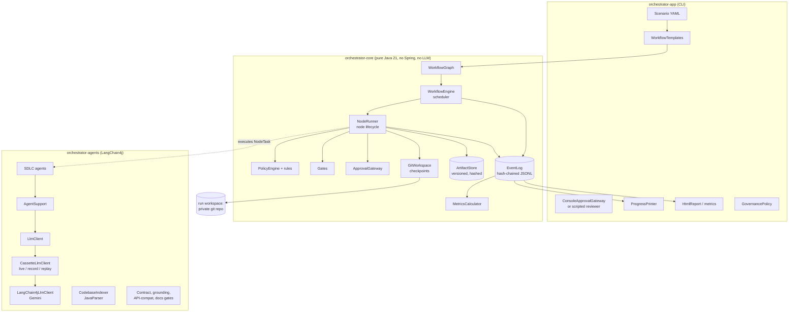
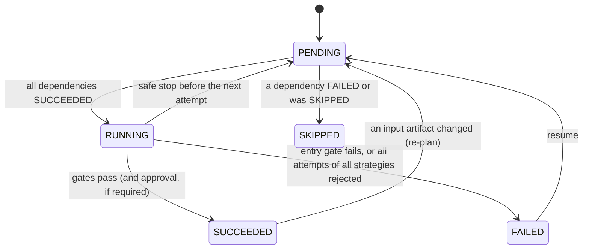

# Architecture

## 1. Goals

The system takes a requirement (well-defined or vague, for new or existing code) and produces a
reviewable engineering outcome: a patch that compiles, passes tests and quality gates, with
documentation, a traceability matrix, release notes and an audit trail. Three properties drive the
design:

1. **Controlled autonomy.** Agents do multi-step work inside explicit boundaries; the engine, not
   the agent, decides what is accepted; humans approve high-impact changes.
2. **Evidence over assertion.** Every acceptance decision is made by deterministic code (compiler,
   tests, schema and policy checks), recorded with its evidence, and reproducible.
3. **Recoverability.** Any failure is bounded (retries, fallback, budgets), reversible (rollback to
   the last green checkpoint) and resumable (from the event log).

## 2. Components



| Module | Responsibility | Key types |
|---|---|---|
| `orchestrator-core` | Execute a graph of governed nodes; record everything | `WorkflowGraph`, `NodeSpec`, `WorkflowEngine`, `NodeRunner`, `Gate`, `PolicyEngine`, `ApprovalGateway`, `GitWorkspace`, `ArtifactStore`, `EventLog`, `MetricsCalculator` |
| `orchestrator-agents` | Do SDLC work with a model; analyse code deterministically | `RequirementsAgent`, `ImpactAnalysisAgent`, `ArchitectAgent`, `PlannerAgent`, `CoderAgent`, `TestAuthorAgent`, `DocsAgent`, `SecurityReviewAgent`, `VerifyAndRepairAgent`, `ReleaseAgent`, `CodebaseIndexer`, `CassetteLlmClient` |
| `orchestrator-app` | Compose workflows per scenario; human interface; reporting | `AgenticCli`, `WorkflowTemplates`, `GovernancePolicy`, `ConsoleApprovalGateway`, `HtmlReport` |
| `url-shortener` | The target service (v1 baseline) | see its [README](../url-shortener/README.md) |

The dependency direction is strict: `app → agents → core`. The core knows nothing about models,
Spring or URL shorteners, which is what makes its behaviour testable with plain lambdas.

## 3. Orchestration model

### 3.1 The graph

A workflow is a `WorkflowGraph` of immutable `NodeSpec`s. A node declares:

| Field | Meaning |
|---|---|
| `dependsOn` | Nodes that must succeed first. A node with several dependencies is a join. |
| `task` / `fallback` | Primary and fallback strategies (`NodeTask`: context → proposal) |
| `retry` | Bounded attempts per strategy with exponential backoff |
| `entryGates` / `exitGates` | Preconditions checked once; checks every attempt must pass |
| `approval` | `ALWAYS` (mandatory sign-off) or `POLICY` (when policy flags the change) |
| `expansion` | Optional: turns accepted outputs into new nodes (the planner's tasks) |
| `timeout` | Wall-clock limit for one attempt |

Every mutation (creation, expansion, removal) is validated: unknown dependencies, duplicates and
cycles are rejected (Kahn's algorithm), so the graph is a DAG at all times.

### 3.2 Node lifecycle



### 3.3 One attempt

```mermaid
sequenceDiagram
  autonumber
  participant S as Scheduler
  participant R as NodeRunner
  participant A as Agent
  participant P as PolicyEngine
  participant W as GitWorkspace
  participant G as Exit gates
  participant H as Reviewer
  S->>R: run(node) on a virtual thread
  R->>R: entry gates (once)
  loop each attempt (primary strategy, then fallback)
    R->>A: execute(context: inputs, feedback of earlier attempts)
    A-->>R: proposal: artifacts, file changes, decisions
    R->>P: evaluate proposal (nothing written yet)
    alt BLOCK finding
      R-->>R: reject; feedback = findings
    else allowed
      R->>W: lock; apply changes
      R->>G: compile / test / contract / grounding checks
      alt a gate fails
        R->>W: rollback to last checkpoint
        R-->>R: reject; feedback = gate evidence
      else gates pass
        opt ALWAYS, or policy REQUIRE_APPROVAL
          R->>H: request (reasons, gate evidence, diff, artifacts)
          H-->>R: approve / reject with comment / approve with amendments
        end
        R->>W: checkpoint commit; unlock
        R-->>S: SUCCEEDED + consumed input hashes + changed keys
      end
    end
  end
  S->>S: expand graph, invalidate stale consumers, schedule next
```

A rejected attempt never leaves a trace in the workspace: changes are applied only under the
workspace lock and either committed as a checkpoint or rolled back. The rejection reason (gate
output, policy findings, reviewer comment, parse error) becomes the next attempt's feedback, so a
retry is a corrected attempt rather than a blind repeat.

### 3.4 Scheduling, parallelism and synchronization

The scheduler loop runs on the caller's thread and owns all scheduling state. Each round it:
enforces stop conditions, marks nodes whose dependencies failed as `SKIPPED`, submits every
`PENDING` node whose dependencies all `SUCCEEDED` (bounded by `maxParallelNodes`), and processes
one completed node. Node runners execute on virtual threads, so a node blocked on a model call or
a human approval costs almost nothing.

Parallel nodes may all touch one workspace. Agent work (the slow part: model calls) runs fully in
parallel; only *apply, gate and commit* is serialized by a workspace lock, as are gates that read
the workspace (`Gate.usesWorkspace()`). This gives real parallelism without two nodes ever
building a half-applied tree.

### 3.5 Dynamic planning and re-planning

**Expansion.** When `plan` succeeds, its expansion parses the plan artifact and inserts one node
per task *between* `plan` and its dependents: each task depends on `plan` (and on the tasks it
names), and every existing dependent of `plan` (here `integrate`) additionally waits for all of
them. A static template ("plan, then integrate") thus accommodates a task list that only exists at
run time. Expansion is a pure function of stored artifacts, so on resume the same subgraph is
rebuilt without calling a model.

**Re-planning.** Each accepted node records the exact version (SHA-256) of every artifact it read.
When an artifact gets a new version (a reviewer amendment, or a re-run producing different output),
the scheduler invalidates every accepted node whose recorded input hash no longer matches, plus
its downstream closure, and runs them again. Nodes spawned by an invalidated planner are removed
and re-expanded; a node that is still running when it becomes stale is re-queued when it reports
back. This is the same idea as an incremental build system (Bazel, Make): re-run what is affected,
keep what is not.

## 4. Cross-stage context and decision lineage

Stages communicate only through the `ArtifactStore`: versioned, content-addressed artifacts
(`requirements.spec`, `design.openapi`, `plan.tasks`, ...). Reading through `NodeContext.input()`
records the consumed version, so every decision an agent records (`DecisionRecorded`) carries
lineage like `requirements.spec@v2#58ea1cf39043`: which version of which input it was based on,
and who produced that version (a node, or `human:<reviewer>`).

## 5. Governance

### 5.1 Autonomy boundary

Agents return proposals; only the engine writes. The `WorkspaceScopeRule` limits writes to
`src/**`, `api/**`, docs and the build file, and **protects the guardrails themselves** (CI
workflows, Checkstyle rules, policy config): otherwise an agent could make a failing gate pass by
weakening the gate. Paths escaping the workspace are rejected twice (policy and `GitWorkspace`).

### 5.2 Policy rules (`GovernancePolicy`)

| Rule | Severity | Why |
|---|---|---|
| `workspace-scope` | BLOCK | Agents stay inside allowed paths; governance files are immutable |
| `secret-leak` | BLOCK | Keys, tokens, private keys, hard-coded passwords in code or artifacts |
| `schema-migration` (edit existing) | BLOCK | Applied migrations are immutable (Flyway checksums, environment drift) |
| `schema-migration` (new) | REQUIRE_APPROVAL | Schema changes are high impact |
| `dependency-change` (`pom.xml`) | REQUIRE_APPROVAL | Supply-chain and licence review |
| `api-contract-change` (`openapi.yaml`) | REQUIRE_APPROVAL | Consumer impact |
| `security-config-change` | REQUIRE_APPROVAL | Security-sensitive code |
| `change-size` (> 800 lines) | REQUIRE_APPROVAL | Large changes deserve a human look |

The engine fails closed: a rule that throws produces a BLOCK, and a gate that throws fails.
`REQUIRE_APPROVAL` cannot be disabled per node: `ApprovalMode` has no "never" option.

### 5.3 Gates

| Gate | Where | Checks |
|---|---|---|
| `requirements-quality` / `requirements-resolved` | requirements | Contract parses; FRs identified with acceptance criteria; NFRs measurable; no open questions after clarification |
| `impact-grounding` | impact-analysis | Every MODIFY/DELETE path exists in the JavaParser index; no ADD of an existing file |
| `api-compatibility` | design | Valid OpenAPI 3; no operation of the baseline contract removed |
| `plan-validity` | plan | 1..8 tasks, kebab ids, acyclic resolvable dependencies, files within `src/main` / `api` |
| `maven-compile` | each implementation task | The project compiles |
| `maven-unit-tests` | tests | Unit tests pass |
| `docs-coverage` | docs | README documents every API path |
| `security-gate` | security-review | No HIGH finding from the deterministic scanner |
| `maven-verify` | verify | Unit + Testcontainers ITs + Checkstyle + 80% coverage |
| `required-artifacts` | entry/exit of several nodes | Stage contracts are met |

Model judgment is advisory only: the security reviewer's findings surface at release approval but
never block, because a model false positive should not stall the pipeline and a model false
negative should not wave a scanner finding through.

### 5.4 Human checkpoints

| Checkpoint | When |
|---|---|
| `clarify` (ambiguous) | Always: the stakeholder answers the open questions by amending `clarification.answers` |
| `design` | Always: architecture, decisions and API contract |
| Any node | When policy flags the proposal (migration, dependency, contract, security config, size) |
| `release` | Always: patch, traceability, security review, release notes |

The reviewer sees why approval is needed, the gate evidence, the artifacts and the diff, and can
**approve**, **reject with a comment** (rolled back; the agent retries with the comment as
feedback) or **approve with amendments** to any artifact (stored as `human:<reviewer>` versions,
triggering re-planning). `ConsoleApprovalGateway` is interactive; the scripted gateway replays
decisions from the scenario file for unattended runs and records them as `scripted-reviewer`.

## 6. Reliability controls

| Control | Mechanism |
|---|---|
| Bounded retries | `RetryPolicy` per node (default 3 attempts, exponential backoff); failure evidence fed forward |
| Timeouts | Per-attempt wall-clock limit; the attempt is cancelled and counts as a failure |
| Fallback | Second strategy after the primary is exhausted: fallback model for design/coder/tests; deterministic `TemplateDocsWriter` for docs |
| Self-repair | `verify` runs the full build first and only asks a model for the smallest fix if it fails, still gated and rolled back |
| Rollback | Every accepted change is a git checkpoint in a private run workspace; rejected attempts reset to it |
| Safe stop | Kill switch file (`agentic stop`), Ctrl-C, run-time / attempt / model-call budgets, failure threshold: no new attempts start, running ones finish atomically, the run ends `PAUSED` |
| Resume | `agentic resume`: accepted nodes and artifacts restored from the log, expansions replayed without model calls, workspace reset to the last checkpoint, failed/unfinished nodes re-run |
| Environment-aware gates | Without Docker, `verify` degrades to unit tests and the degradation is recorded in the run settings |

## 7. Observability and traceability

**Event log.** Every state change is a typed `RunEvent` (21 types: node started, gate evaluated,
policy evaluated, attempt failed, fallback, rollback, approval requested/resolved, artifact
produced, decision recorded, model called, graph expanded, node invalidated, stop requested, ...)
appended to `events.jsonl`. Each envelope carries a sequence number, timestamp and
`hash = SHA-256(prevHash, seq, runId, time, event)`, so editing or deleting any earlier line breaks
the chain; `agentic verify-log` checks it.

**Metrics** are a projection of the log (`MetricsCalculator`), so they can be recomputed for any
historical run and can never disagree with the audit trail:

| Metric | Definition |
|---|---|
| Node success rate | succeeded / (succeeded + failed), final states |
| First-pass yield | accepted nodes that passed on their first attempt / accepted nodes |
| Retry rate | attempts beyond the first / all attempts |
| Rollback rate | rollbacks / all attempts |
| MTTR | mean time from a node's first failed attempt to its eventual success |
| End-to-end latency | first to last event; split into human wait (approvals) and machine time |
| Cost | model calls, input/output tokens |
| Run success rate | across runs (`agentic metrics`) |

**Run report.** `report.html` renders the graph coloured by final state, the KPIs, every human
checkpoint, every decision with its lineage, every gate/policy/recovery event with evidence, all
artifact versions and the full audit log.

## 8. Agents

- **One seam to the model.** Agents call `AgentSupport.ask()` → `LlmClient`. The LangChain4j
  adapter sends a JSON schema derived from the response record (`JsonSchemas.jsonSchemaFrom`), so
  Gemini constrains decoding to the contract. A reply that does not parse fails the attempt with
  the parse error as feedback.
- **Record/replay.** `CassetteLlmClient` stores each exchange keyed by its position in the run
  (`node/e<execution>/attempt-<n>/<strategy>/<agent>`), not by prompt hash, because prompts contain
  non-deterministic text such as build output. The prompt hash is still stored; a replay whose
  prompt differs is labelled `replay-drift`. Replay needs no network or key, which makes runs
  reproducible for reviewers and CI. Hand-authored fixtures are labelled `fixture`.
- **Grounding first.** Brownfield runs index the codebase with JavaParser (types, roles,
  constructor dependencies, endpoints including constant-based paths, migrations, tests) before
  any model reasons about impact; the grounding gate checks the model's claims against that index.
- **Context.** Code-writing agents receive the task, the approved design and contract, the
  engineering conventions ([`config/agent-skills`](../config/agent-skills/java-spring-boot.md)) and
  the workspace sources under a character budget, most relevant files first.

## 9. Run directory

```
.runs/<run-id>/
  run.json          scenario, model mode, approval mode (for resume)
  events.jsonl      hash-chained audit log: the source of truth
  artifacts/        every artifact version (key/v<n>.txt)
  workspace/        private git repo: baseline commit + one checkpoint per accepted change
  report.html       run report        metrics.json   computed metrics
  graph.mmd         final graph       release.patch  the reviewable outcome
  STOP              kill switch (created by `agentic stop`)
```

## 10. Production path

The prototype runs in one process. The seams are where production would differ:

| Concern | Prototype | Production |
|---|---|---|
| Event log | JSONL file, hash-chained | Postgres or Kafka, signed checkpoints, WORM storage |
| Scheduler | In-process | Durable workflow runtime (Temporal-style) or the same engine behind a lease per run |
| Workspace | Local git repo | Ephemeral container per run; branch + pull request on the real repository |
| Approvals | Terminal / scripted | Pull-request review or ticketing integration, SSO identities |
| Gates | Local Maven | CI pipeline jobs; SAST/SCA tools as gates |
| Telemetry | Event log + report | OpenTelemetry spans per node/attempt exported from the same events |
| Context | Whole source tree under a budget | Retrieval over a code index for large repositories |
