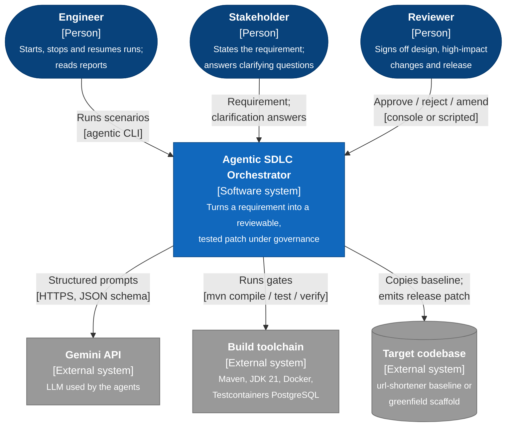
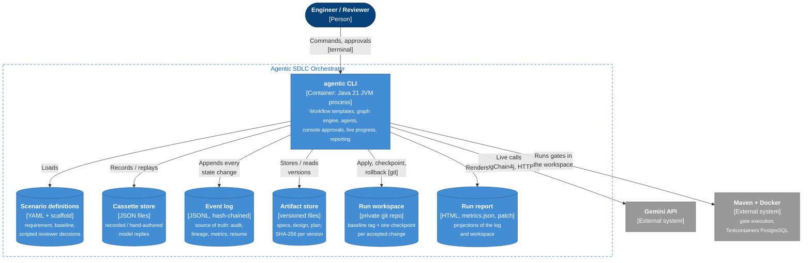
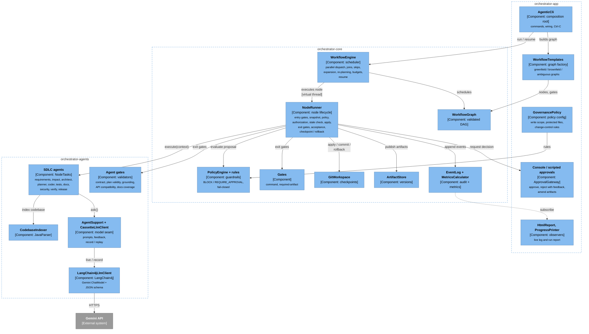
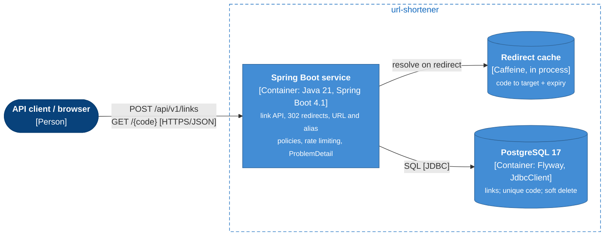

# C4 model

The system at the four levels of the [C4 model](https://c4model.com): **context**, **containers**,
**components**, and **dynamic** views of the workflow. The diagrams use C4 notation (element type
in brackets, standard C4 colours, boundaries as dashed groups) drawn with Mermaid flowcharts, which
lay out far more legibly than Mermaid's experimental C4 renderer. Dynamic views use the
sequence-diagram form the C4 model allows.

Legend: <span style="color:#08427b">■</span> person ·
<span style="color:#1168bd">■</span> the system ·
<span style="color:#438dd5">■</span> container ·
<span style="color:#85bbf0">■</span> component ·
<span style="color:#999999">■</span> external system

## Level 1: System context

Who uses the system and what it depends on.



| Element | Responsibility |
|---|---|
| Engineer | Operates runs: `agentic run / stop / resume / report / metrics / verify-log` |
| Stakeholder | Owns the requirement; answers the open questions at the clarification checkpoint |
| Reviewer | Human authority at checkpoints; can reject with feedback or amend any artifact |
| Agentic SDLC Orchestrator | Orchestrates SDLC agents under policy, gates, approvals and an audit log |
| Gemini API | Model behind every agent in live/record mode; replaced by cassettes in replay |
| Build toolchain | Deterministic gates: compiler, unit and integration tests, Checkstyle, coverage |
| Target codebase | Read-only input; each run works on a private copy and outputs `release.patch` |

## Level 2: Containers

One JVM process plus file-based stores per run. "Container" is meant in the C4 sense (a runtime
unit or data store), not a Docker container.



| Container | Technology | Notes |
|---|---|---|
| agentic CLI | Java 21; shaded jar of `orchestrator-app` + `orchestrator-agents` + `orchestrator-core` | Single process; virtual threads for parallel nodes |
| Scenario definitions | `scenarios/*.yaml`, `scenarios/scaffolds/` | Versioned with the code |
| Cassette store | `cassettes/<scenario>/*.json` | Keyed by `node/e<execution>/attempt-<n>/<strategy>/<agent>` |
| Event log | `.runs/<id>/events.jsonl` | `hash = SHA-256(prev, seq, runId, time, event)`; checked by `verify-log` |
| Artifact store | `.runs/<id>/artifacts/<key>/v<n>.txt` | Content-addressed; drives re-planning |
| Run workspace | `.runs/<id>/workspace/` (git) | The developer's repository is never touched |
| Run report | `.runs/<id>/report.html`, `metrics.json`, `release.patch` | Pure projections of the log and workspace |

## Level 3: Components of the agentic CLI

Inside the process, by module. Dependencies point one way:
`orchestrator-app → orchestrator-agents → orchestrator-core`.



## Dynamic view 1: one run, end to end (container level)

The SDLC workflow as it executes: the order in which containers and people interact during a
brownfield run.

```mermaid
sequenceDiagram
  autonumber
  actor E as Engineer
  participant CLI as agentic CLI<br/>[container]
  participant S as Scenarios +<br/>cassettes [stores]
  participant W as Run workspace<br/>[git]
  participant L as Event log +<br/>artifacts [stores]
  participant M as Gemini API<br/>[external]
  participant T as Maven + Docker<br/>[external]
  actor R as Reviewer

  E->>CLI: agentic run brownfield
  CLI->>S: load scenario, workflow template inputs
  CLI->>W: copy baseline, git init, tag baseline
  CLI->>L: RunStarted (settings, requirement hash)
  par requirements
    CLI->>M: requirements agent (structured prompt)
  and codebase scan
    CLI->>W: JavaParser index (no model)
  end
  CLI->>M: impact analysis, grounded against the index
  CLI->>M: architect: design + OpenAPI contract
  CLI->>R: design sign-off (diff, gate evidence)
  R-->>CLI: approve / reject with comment / amend
  CLI->>M: planner: tasks with dependencies
  Note over CLI: graph expands: one node per task
  par each implementation task
    CLI->>M: coder proposal
    CLI->>T: mvn compile (exit gate)
    CLI->>W: checkpoint commit, or rollback + retry
  end
  par tests then verify then security review
    CLI->>M: test author (mvn test), bounded repair (mvn verify), security reviewer
  and docs
    CLI->>M: tech writer (docs coverage; may only write docs)
  end
  CLI->>T: final validation on tree T: mvn verify, scanner, contract, docs
  CLI->>R: release sign-off on tree T (patch, traceability, notes, evidence)
  R-->>CLI: approve
  CLI->>L: RunFinished, every step above was logged as events
  CLI->>E: report.html, metrics, release.patch
```

## Dynamic view 2: one governed node (component level)

What happens, in order, inside one implementation node. This is where the controls act; the full
lifecycle (fallback, timeouts, safe stop) is in
[architecture §3.3](architecture.md#33-one-attempt).

```mermaid
sequenceDiagram
  autonumber
  participant EN as WorkflowEngine<br/>[component]
  participant NR as NodeRunner<br/>[component]
  participant CA as CoderAgent<br/>[component]
  participant AS as ArtifactStore<br/>[component]
  participant GM as Gemini API<br/>[external]
  participant PE as PolicyEngine<br/>[component]
  participant GW as GitWorkspace<br/>[component]
  participant MV as Maven<br/>[external]
  actor RV as Reviewer
  participant EL as EventLog<br/>[component]

  EN->>NR: dependencies succeeded: run(node) on a virtual thread
  NR->>CA: execute(context: feedback, snapshot of base revision B)
  CA->>AS: read plan, design, contract (versions recorded)
  CA->>GM: structured prompt, reply must match CodeProposal
  CA-->>NR: proposal P: file changes, decisions
  NR->>PE: evaluate P against B (nothing written yet)
  alt BLOCK
    NR->>EL: PolicyEvaluated, AttemptFailed
    NR->>NR: retry with findings as feedback
  else build file changed (REQUIRE_AUTHORIZATION)
    NR->>RV: authorize P (preview diff; nothing written or built)
    RV-->>NR: authorize / refuse
  end
  NR->>GW: lock; files of P changed since B? reject as stale
  NR->>GW: apply P, tree hash T
  NR->>MV: mvn compile on T
  alt gate fails
    NR->>GW: rollback to checkpoint
    NR->>EL: GateEvaluated (FAIL, T), RollbackPerformed, AttemptFailed
    NR->>NR: retry with compiler output as feedback
  else gate passes
    opt REQUIRE_APPROVAL (e.g. new migration)
      NR->>RV: accept P on T (reasons, diff, gate evidence)
      RV-->>NR: approve / reject / amend (amendments validated)
    end
    NR->>GW: still T and inputs current? checkpoint commit, unlock
    NR->>EL: CheckpointCreated, ArtifactProduced, NodeSucceeded (commit point)
  end
  NR-->>EN: outcome + consumed input hashes
  EN->>EN: expand graph, invalidate stale consumers, schedule next
```

## Supplementary: the target service (url-shortener)


