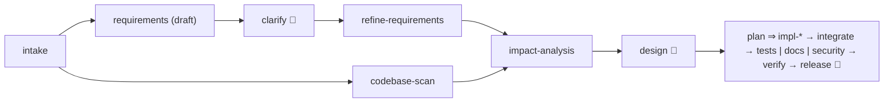

# Scenario: ambiguous requirement

```bash
./agentic run ambiguous --llm record --approvals interactive   # you answer the questions
./agentic run ambiguous
```

## Requirement ([scenarios/ambiguous.yaml](../../scenarios/ambiguous.yaml))
> From: Marketing team. "Our short links feel slow during campaigns and we have no idea what's
> happening with them. Can you make it handle heavy traffic and give us some stats?"

"Heavy traffic", "slow", "some stats" and the privacy implications are all undefined. Building
straight from this would mean guessing.

## How the workflow handles it



1. **Detect and normalise.** The requirements agent produces a *draft* spec in which every
   ambiguity is an explicit question (`Q-1`, `Q-2`, ...) with options, why it matters, and a
   recommended default. Nothing is guessed silently.
2. **Clarify at a human checkpoint.** `clarify` (deterministic, no model) renders the question
   sheet and a pre-filled answer sheet with the defaults. The stakeholder approves by amending
   `clarification.answers`; anything left untouched is an explicit, recorded decision to accept
   the default. In unattended runs the scripted answers in the scenario file are applied
   (2,000 redirects/s with p99 < 50 ms, per-link totals and 30-day daily counts, top referrers, up to
   one minute of lag, no personal data, 90-day retention).
3. **Refine.** `refine-requirements` folds the answers into the final spec; the
   `requirements-resolved` gate rejects it if any question is still open.
4. **Re-plan if the answers change.** If the stakeholder later amends the answers (for example at
   design sign-off), every node that consumed the old version is invalidated and re-run
   ([ADR-0005](../adr/0005-replanning-by-content-hash.md)).
5. From there it is the brownfield workflow on the existing service, with the clarified spec as
   the contract.

## Results

*Pending the live recording (needs `GEMINI_API_KEY` / `AGENTIC_MODEL`).*
