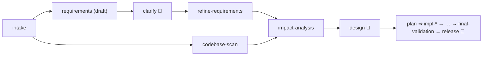

# Scenario: ambiguous requirement

```bash
./agentic run ambiguous --approvals scripted       # demonstration answers
./agentic run ambiguous --approvals interactive    # you answer the questions
```

## Input
[scenarios/ambiguous.yaml](../../scenarios/ambiguous.yaml): "Our short links feel slow during
campaigns and we have no idea what's happening with them. Can you make it handle heavy traffic and
give us some stats?"

## Questions, answers, refinement



1. The draft spec ([requirements.draft](../evidence/ambiguous/artifacts/requirements.draft/v1.txt))
   turns the request into five questions, each with options, why it matters and a default:
   traffic level, latency target, which statistics, exactness and freshness, privacy and
   retention ([questions](../evidence/ambiguous/artifacts/clarification.questions/v1.txt)).
2. `clarify` stops for the stakeholder. In this evidence the answers are **demonstration answers
   written with the scenario**, not from a real stakeholder, and the audit log records them as a
   `scripted-demo` amendment
   ([answers](../evidence/ambiguous/artifacts/clarification.answers/v2.txt)). The amendment is
   validated (every question must be answered) before it is accepted.
3. `refine-requirements` folds them in; the `requirements-resolved` gate rejects a spec with open
   questions ([final spec](../evidence/ambiguous/artifacts/requirements.spec/v1.txt)): best-effort
   statistics with up to a minute of lag, daily counts up to 90 days, no personal data, and an NFR
   of 2,000 redirects/s with p99 < 50 ms **measured by a load test, not a CI gate**.
4. From there it is the brownfield workflow on v1, analytics only (issue #1 was not asked for and
   is left as documented).

## Results ([evidence](../evidence/ambiguous))

18 nodes, 18 attempts, 5 decisions (clarify, design, schema migration, change size, release),
12 fixture model calls, 127 events, about 36 s; final validation and release on tree
`56afae684437`. Output: [release.patch](../evidence/ambiguous/release.patch).

The performance answer is checked by [`tools/loadtest/redirect-load.sh`](../../tools/loadtest/redirect-load.sh);
the one measurement taken is in [testing.md](../testing.md#load-test) and is not a production
capacity claim.

## Limits
Hand-authored replies and demonstration answers. With a real stakeholder, run it with
`--approvals interactive` and edit `clarification.answers` at the checkpoint.
