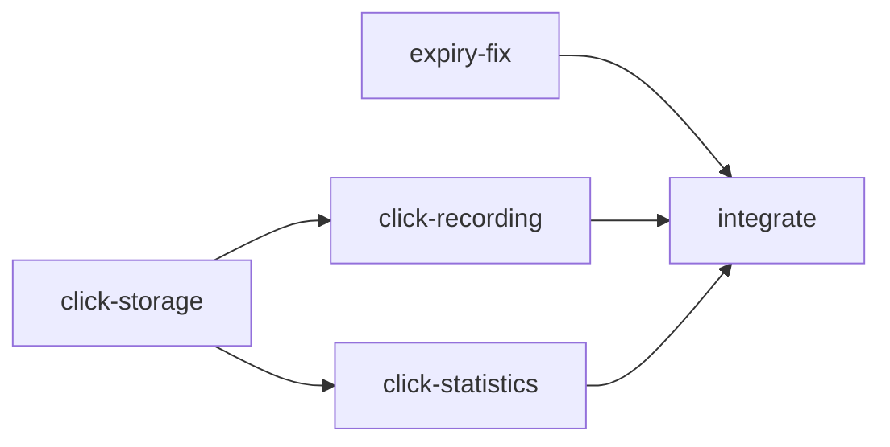

# Scenario: brownfield (enhancement + bug fix in the existing service)

```bash
./agentic run brownfield --approvals scripted        # or --approvals interactive
tools/final-service.sh                               # v1 + this run's patch = the final service
```

## Input
[scenarios/brownfield.yaml](../../scenarios/brownfield.yaml): (1) record every successful
redirect (timestamp, referrer host, coarse user-agent family) without noticeable latency and
expose `GET /api/v1/links/{code}/stats`; no raw IPs. (2) Issue #1: expired links keep redirecting
while cached.

## Normalized requirements
FR-1 recording, FR-2 statistics, FR-3 privacy, FR-4 90-day retention, FR-5 issue #1; NFRs for
redirect latency and compatibility. The requirements stage raises one open question: **Q-1**
"every redirect" and "no noticeable latency" conflict, because a durable record needs a write on
the hot path ([requirements.spec](../evidence/brownfield/artifacts/requirements.spec/v1.txt)).

## Codebase reasoning
`codebase-scan` (JavaParser, deterministic) runs in parallel with `requirements`; impact analysis
names `RedirectController`, `LinkResolver`, `CacheConfiguration`, configuration, a new migration
and the click package, and is checked against the index (`impact-grounding`).

## Decomposition



`expiry-fix` and `click-storage` run in parallel, then `click-recording` and `click-statistics`.

## Decisions and approvals

| Node | Kind | Reasons | Decision (scripted demonstration) |
|---|---|---|---|
| design, attempt 1 | acceptance | sign-off, api-contract-change | **rejected**: "make recording explicitly asynchronous and bounded, state it is best effort (Q-1), add retention"; rolled back, the architect retried with the comment |
| design, attempt 2 | acceptance | sign-off, api-contract-change | approved: best effort accepted for Q-1 ([ADR-0017](../adr/0017-best-effort-click-analytics.md)) |
| impl-click-storage | acceptance | schema-migration (V2) | approved |
| tests | acceptance | change-size (1,118 lines) | approved |
| release | acceptance on tree `6ed596e7890b` | sign-off | approved |

## Results ([evidence](../evidence/brownfield))

17 nodes, 18 attempts (1 retry after the rejection, 1 rollback), MTTR 1.3 s, 13 fixture model
calls, 127 events, about 39 s. Final validation on tree `6ed596e7890b`: `mvn verify` (153 unit +
24 ITs on PostgreSQL including `CachedLinkExpiryIT`, `ClickAnalyticsIT`, `ContractConformanceIT`;
Checkstyle; coverage gate), security scan, structural contract compatibility against v1, docs
coverage; the model security review (advisory: unauthenticated statistics, referrer host
privacy) covers that tree.

Output: [release.patch](../evidence/brownfield/release.patch) (28 files),
[traceability](../evidence/brownfield/artifacts/release.traceability/v1.txt),
[release notes](../evidence/brownfield/artifacts/release.notes/v1.txt).

## Limits
Hand-authored replies; analytics are best effort by an explicit design decision; management and
statistics endpoints are unauthenticated (see the final service README's scale boundaries).
