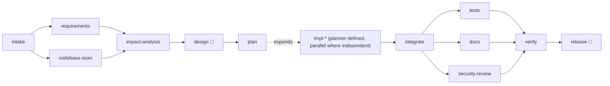

# Scenario: brownfield (enhancement + bug fix in the existing service)

```bash
./agentic run brownfield --llm record --approvals interactive   # live, you review
./agentic run brownfield                                         # replay the recording
```

## Requirement ([scenarios/brownfield.yaml](../../scenarios/brownfield.yaml))
1. **Click analytics:** record each successful redirect (timestamp, referrer host, coarse
   user-agent family) without adding noticeable redirect latency; expose
   `GET /api/v1/links/{code}/stats` with total clicks, last click and daily counts for 7 days; no
   raw IP addresses.
2. **Bug fix (issue #1):** expired links keep redirecting while cached; they must return 410.

## What it demonstrates
- **Codebase reasoning:** `codebase-scan` (JavaParser, deterministic) runs in parallel with
  `requirements`; `impact-analysis` joins both and must cite only files that exist
  (`impact-grounding` gate).
- **Two change types in one plan:** an additive feature (new table, async recording, new
  endpoint) and a targeted bug fix; independent tasks run in parallel.
- **Reviewer rejection loop:** the scripted reviewer rejects the first design ("make recording
  explicitly asynchronous and bounded; state a retention policy"). The design is rolled back and
  the architect retries with that comment as feedback.
- **Change control:** the new Flyway migration and the API-contract change are routed to a human;
  editing the applied V1 migration would be blocked; the contract must stay backward compatible
  (`api-compatibility` gate: every v1 operation kept).

## Decomposition



## Validation per stage

| Stage | Gate |
|---|---|
| requirements | `requirements-quality`: identified FRs with acceptance criteria, measurable NFRs |
| impact-analysis | `impact-grounding`: no invented files |
| design | `required-artifacts`, `api-compatibility`; human sign-off |
| plan | `plan-validity`: acyclic, ≤ 8 tasks, files in scope |
| impl-* | `maven-compile`; policy (migration needs approval) |
| tests | `maven-unit-tests` |
| docs | `docs-coverage` (fallback: template writer) |
| security-review | scanner HIGH findings block |
| verify | full `mvn verify` incl. Testcontainers ITs and 80% coverage (self-repair on failure) |
| release | patch, traceability, notes; human sign-off |

## Results

*Pending the live recording (needs `GEMINI_API_KEY` / `AGENTIC_MODEL`).* The recording will be
committed under `cassettes/brownfield/` and its report under `docs/evidence/brownfield/`. The
deterministic [drill](drill.md) runs this same workflow with planted faults today.
