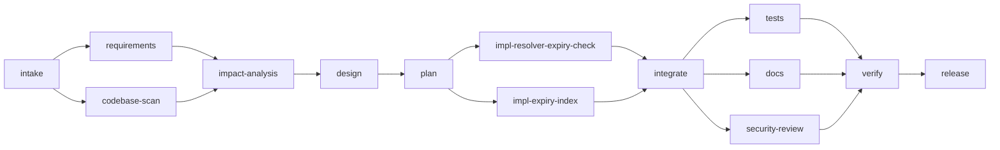

# Scenario: governance drill

**Question it answers:** do the controls actually work when things go wrong?

The drill runs the real brownfield workflow (the same `WorkflowTemplates`, agents, policy, gates
and Maven builds) with **hand-authored model replies** instead of a live model, and plants one
fault per control. It needs no API key, takes about 25 seconds, and is deterministic: two runs
produce identical retries, rollbacks, fallbacks and MTTR.

```bash
./agentic run drill            # replay mode and the scripted reviewer are picked automatically
```

The fixtures are generated by [`tools/make-drill-cassettes.py`](../../tools/make-drill-cassettes.py)
from validated sources in [`tools/drill-fixtures`](../../tools/drill-fixtures). Every fixture is
labelled `fixture:hand-authored` in the audit log: nothing pretends to be a model.

## Requirement
> Fix issue #1: an expired link keeps redirecting while it is in the redirect cache. Once a link's
> expiresAt has passed, `GET /{code}` must return 410 Gone even if it was cached. Also add a
> database index on `links.expires_at` for the planned expired-link cleanup job.

## Planted faults and how the system handled them

| # | Fault | Control | What happened (from the audit log) |
|---|---|---|---|
| 1 | Impact analysis names `link/LinkCache.java`, which does not exist | `impact-grounding` gate against the JavaParser index | Attempt 1 rejected with "no such file in the codebase index"; attempt 2 grounded |
| 2 | At design sign-off the reviewer adds a requirement (FR-3: deleted links stop redirecting immediately even when cached) | Approval with amendment, then content-hash re-planning | `requirements.spec` v2 stored as `human:scripted-reviewer`; `impact-analysis` invalidated (`e47d5836 -> 58ea1cf3`) together with `design`; both re-ran (execution 2) and design was re-approved |
| 3 | The coder edits the applied `V1__create_links.sql` | `schema-migration` policy (BLOCK) | Rejected before anything was written; attempt 2 added `V2__index_links_expires_at.sql`, which policy routed to a human as a schema change |
| 4 | The coder forgets to create `CachedLink.java` | `maven-compile` gate (real build) | Compile failed; workspace rolled back to the checkpoint; attempt 2 (with the compiler output as feedback) compiled |
| 5 | The docs model returns `503 UNAVAILABLE` twice | Bounded retries, then fallback strategy | Fallback `TemplateDocsWriter` regenerated the README API reference from the contract; `docs-coverage` gate passed |

Meanwhile the normal path ran for real: the plan expanded into two **parallel** implementation
tasks; `tests`, `docs` and `security-review` ran in parallel after `integrate` and joined at
`verify`, which ran the full `mvn verify` (unit tests, Testcontainers integration tests applying
the new migration on PostgreSQL 17, Checkstyle, the 80% coverage gate); the release node produced
the patch, traceability matrix and release notes, and waited for sign-off.

## Decomposition



| Task (from the plan) | Requirements | Files |
|---|---|---|
| `resolver-expiry-check` | FR-1, FR-3, NFR-1 | `CachedLink.java` (new), `LinkResolver.java`, `CacheConfiguration.java` |
| `expiry-index` | FR-2 | `V2__index_links_expires_at.sql` (new) |

## Results

| Metric | Value |
|---|---|
| Status | SUCCEEDED, 14 nodes, 0 failed |
| Attempts / retries | 21 / 5 (retry rate 0.24) |
| First-pass yield | 86% of nodes |
| Rollbacks / fallbacks | 1 / 1 |
| Gate failures / policy blocks | 2 / 1, all recovered |
| Human checkpoints | 4 (design twice, schema change, release) |
| Re-plan invalidations | 2 |
| MTTR | 3.2 s |
| End-to-end | 22.8 s (of which ~10 s is the full `mvn verify`) |
| Audit log | 129 events, hash chain verified |

Evidence (committed): [run report](../evidence/drill/report.html) (open locally) ·
[audit log](../evidence/drill/events.jsonl) · [metrics](../evidence/drill/metrics.json) ·
[patch](../evidence/drill/release.patch) ·
[traceability](../evidence/drill/artifacts/release.traceability/v1.txt) ·
[release notes](../evidence/drill/artifacts/release.notes/v1.txt).

The produced patch is the actual fix for issue #1 described in
[ADR-0013](../adr/0013-redirect-cache-and-expiry.md), with three new regression tests.
