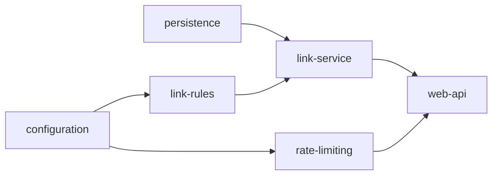

# Scenario: greenfield (build the service from a requirement)

```bash
./agentic run greenfield --approvals scripted        # or --approvals interactive
```

## Input
[scenarios/greenfield.yaml](../../scenarios/greenfield.yaml): a URL shortener for customer
communications (create with optional alias and expiry, redirect, read, delete, safe on the public
internet, rate-limited creation, consistent errors, OpenAPI contract, PostgreSQL). Starting point:
[`scenarios/scaffolds/greenfield`](../../scenarios/scaffolds/greenfield), an empty Spring Boot 4
project with the build gates and an integration-test base class.

## Normalized requirements
6 functional requirements with acceptance criteria and 3 measurable NFRs
([requirements.spec](../evidence/greenfield/artifacts/requirements.spec/v1.txt)).

## Decomposition (from the plan)



`configuration` and `persistence` run in parallel, then `link-rules` and `rate-limiting`; every
task must compile against the ones before it. Then `tests` → `verify` → `security-review`, with
`docs` in parallel, → `final-validation` → `release`.

## Decisions and approvals

| Node | Kind | Reasons | Decision (scripted demonstration) |
|---|---|---|---|
| design | acceptance | sign-off, api-contract-change | approved |
| impl-persistence | acceptance | schema-migration (V1) | approved |
| impl-web-api | **authorization**, before the build file was written or built | dependency-change (`pom.xml`: springdoc UI) | authorized |
| tests | acceptance | change-size (1,507 lines) | approved |
| release | acceptance on tree `8451d0db90c7` | sign-off | approved |

## Results ([evidence](../evidence/greenfield))

17 nodes succeeded, 17 attempts, no retries, 5 checkpoints decided, 13 fixture model calls, 122
hash-chained events, about 40 s. Final validation re-ran `mvn verify` (126 unit + 16
Testcontainers ITs, Checkstyle, 80% coverage), the security scan, the contract check and docs
coverage on tree `8451d0db90c7`; release was accepted on that tree.

Output: [release.patch](../evidence/greenfield/release.patch). Applied to the scaffold it is
byte-identical to [`url-shortener/`](../../url-shortener) (the only difference is the scaffold's
empty `.gitkeep`).

## Limits
Hand-authored replies: shows decomposition, gating and approvals on a real build, not model
quality. Because the fixture plan is correct, this run shows no recovery; the
[drill](drill.md) covers failures.
